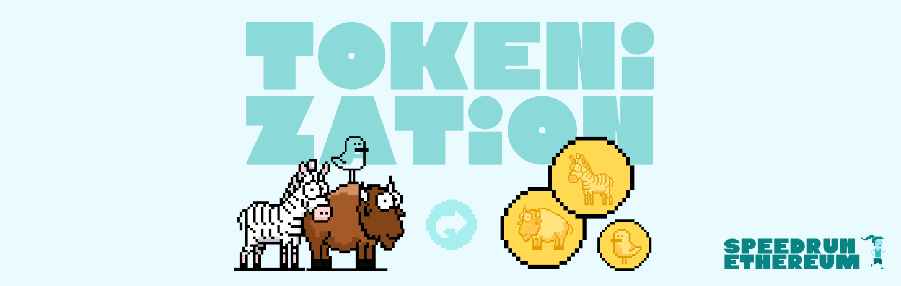
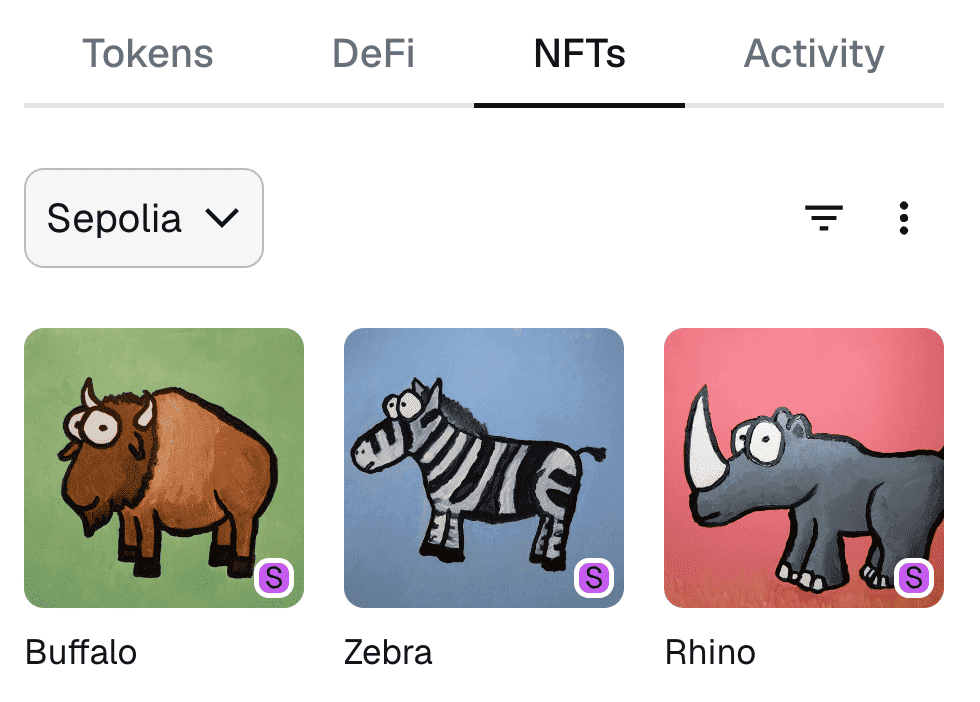

# Tokenization

Mint and view collectible NFTs with metadata stored on IPFS.

- **Live demo:** https://nft-challenge-1.vercel.app/
- **Contract (Sepolia):** [0x83D9554Ac25e3d1da78Da5e54b8D02F061ECeCF7](https://sepolia.etherscan.io/address/0x83D9554Ac25e3d1da78Da5e54b8D02F061ECeCF7)
- **Stack:** Scaffold-ETH 2, Foundry, Next.js, wagmi/viem

Part of [SpeedRunEthereum](https://speedrunethereum.com).
