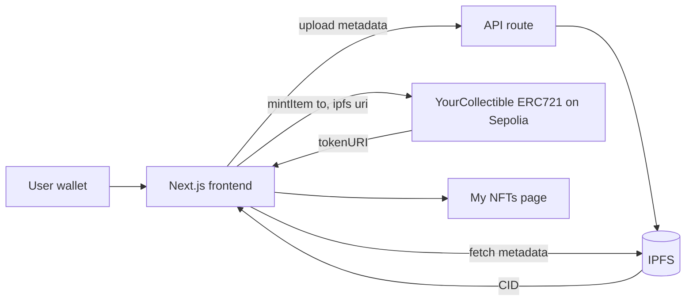

# Tokenization

Mint and view collectible NFTs with metadata stored on IPFS.

- **Live demo:** https://nft-challenge-1.vercel.app/
- **Contract (Sepolia):** [0x83D9554Ac25e3d1da78Da5e54b8D02F061ECeCF7](https://sepolia.etherscan.io/address/0x83D9554Ac25e3d1da78Da5e54b8D02F061ECeCF7)
- **Stack:** Scaffold-ETH 2, Foundry, Next.js, wagmi/viem

## Tech and flow

- **Solidity + OpenZeppelin** (`ERC721`, `Enumerable`, `URIStorage`, `Ownable`): NFT contract, `mintItem(to, uri)` mints a token with a metadata URI.
- **IPFS** (Next.js API routes): stores NFT metadata off-chain.
- **Foundry**: build, test, deploy to Sepolia.
- **Next.js + wagmi/viem + RainbowKit**: wallet connect, mint, and list your NFTs.

Part of [SpeedRunEthereum](https://speedrunethereum.com).
